# Focusline

**A reading marker for KOReader that keeps your place, one sentence at a time.**

&nbsp;

Focusline highlights the sentence (or the single word) you are reading right
now. Press your page-turn button and the highlight moves to the next
sentence. When it reaches the bottom of the page, the page turns by itself.

It helps if you lose your line easily, get distracted by the rest of the
page, or simply want to pick a book back up at the exact sentence where you
stopped.

  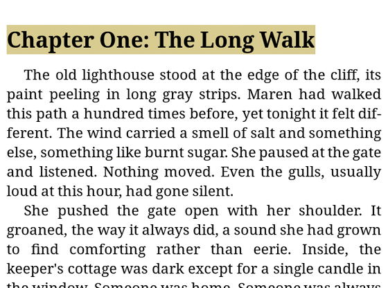

## Features

- **Marks one sentence or one word at a time**, and follows you through the
  book.
- **17 styles**, from plain and understated to decorative: Box, Border,
  Pinned, a plain Underline, four underline variants (dashed, dotted,
  double, wavy), seven ornamental underlines (diamonds, flourish, leaves,
  scroll, flower, bow, quill), Strikethrough and Invert.
- **Eight soft colors**: Muted Rose, Sage, Soft Apricot, Dusty Blue, Muted
  Gold, Lavender, Powder Cyan and Dusty Pink.
- **A small picture beside the line** if you like: a flower, star, leaf or
  arrow, or a picture of your own.
- **Works with your page-turn buttons**, including Bluetooth page turners.
- **Remembers your place.** Close the book, open it tomorrow, and the marker
  is on the same sentence.
- **Stays put while you browse.** With the persistent marker (on by
  default), turning pages yourself never moves the marker off its sentence;
  it only moves when you tell it to.
- **Can move on its own**, either at a steady interval you set, or
  automatically timed to how long each sentence takes to read.
- **Tap the marker** to change its color or style, or to write a note on it.
- **Works in day mode and night mode.**

## Screenshots

| The marker on a sentence | Word by word |
| --- | --- |
| 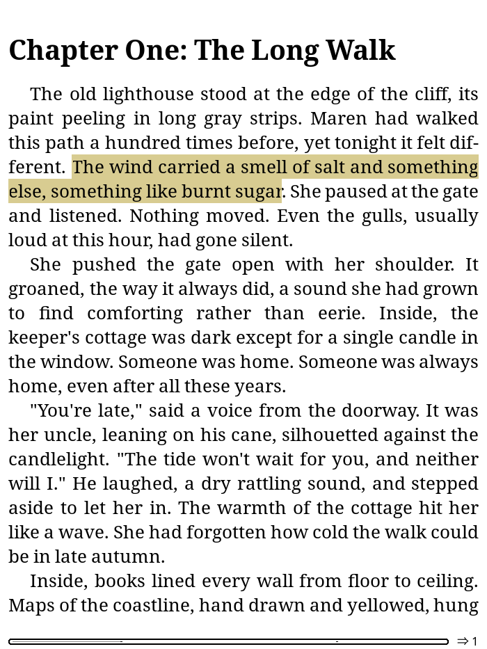 | 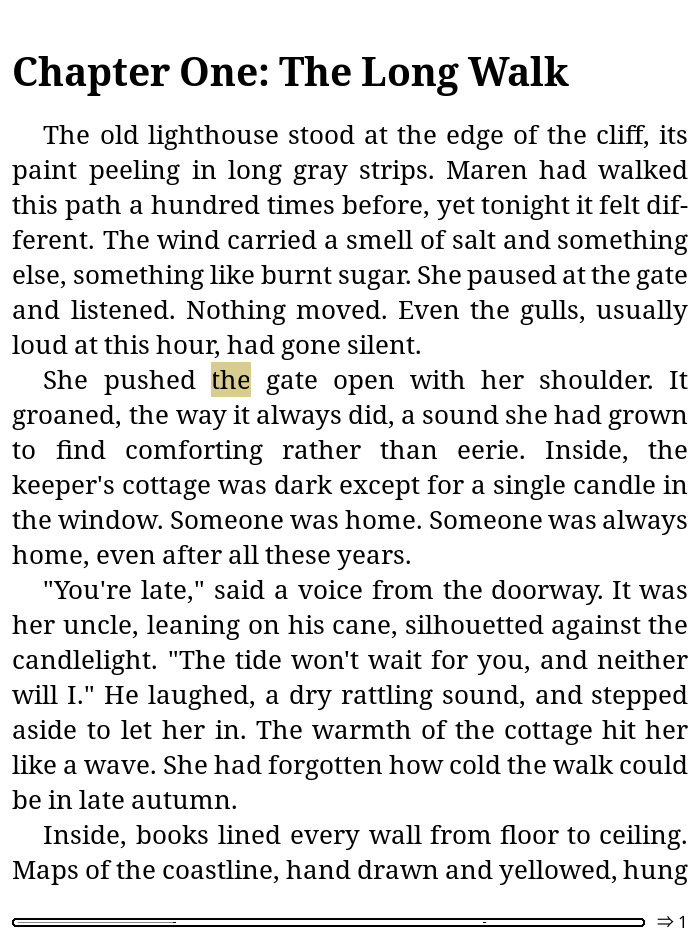 |
| **Tap the marker to change it** | **A picture beside the line** |
| 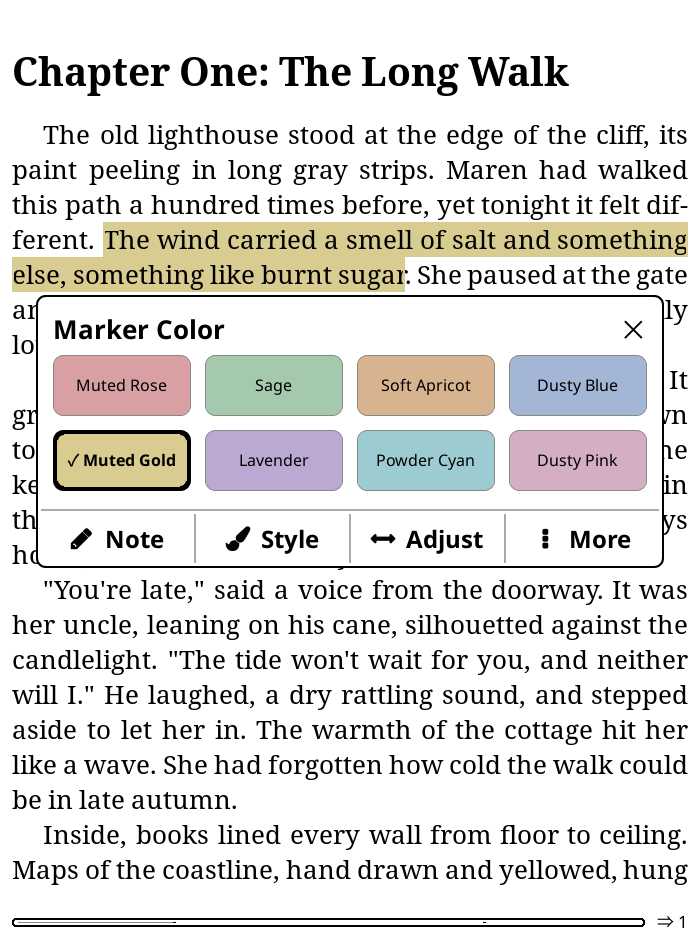 | 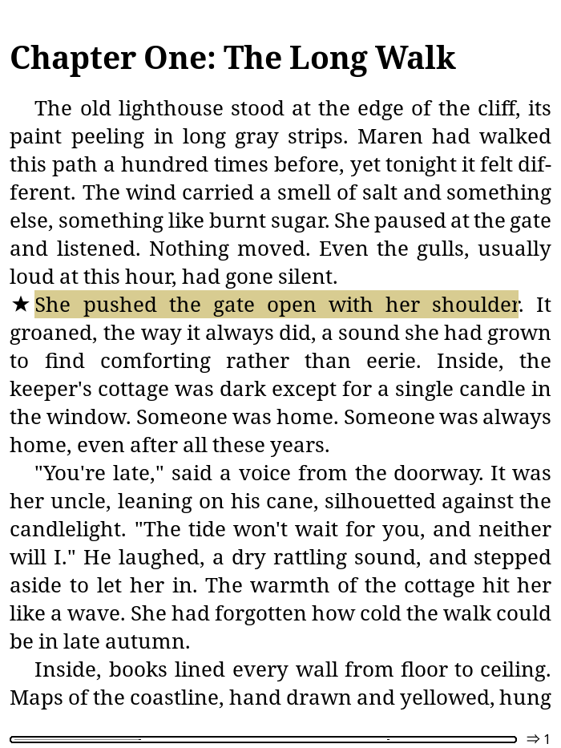 |
| **Night mode** | **PDF files** |
| 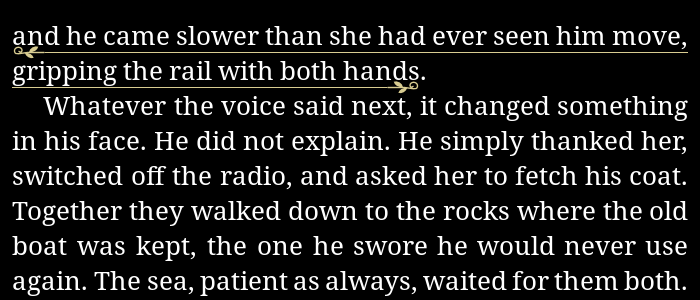 | 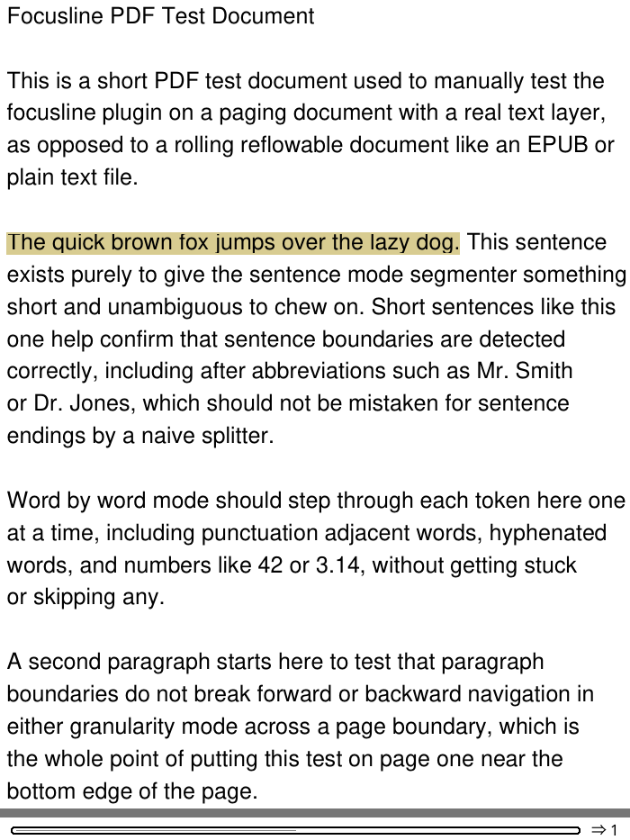 |

The 17 styles, from the plain to the decorative:

  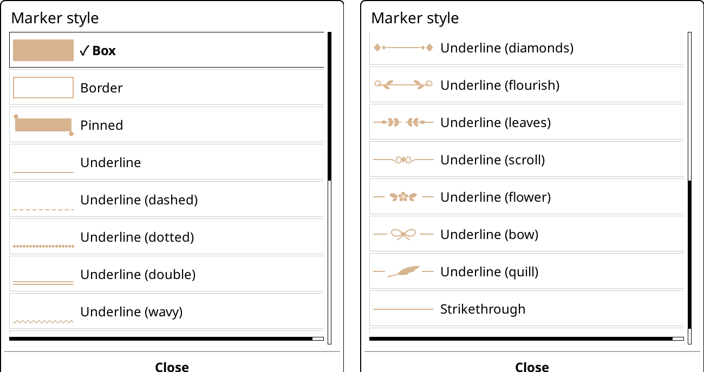

## How to install

You need [KOReader](https://koreader.rocks) on your e-reader, phone or
tablet.

1. **Download** the file with the green button at the top of this page. You
   get a file called `focusline.koplugin.zip`.
2. **Unzip it** on your computer. You get a folder called
   `focusline.koplugin`.
3. **Connect your device** to the computer with its USB cable.
4. **Copy the `focusline.koplugin` folder** into KOReader's `plugins` folder
   on the device:

   | Device | Where the `plugins` folder is |
   | --- | --- |
   | Kindle | `koreader/plugins` |
   | Kobo | `.adds/koreader/plugins` |
   | PocketBook | `applications/koreader/plugins` |
   | Android | `koreader/plugins` |

   On Kobo the `.adds` folder is hidden. Turn on "show hidden files" on your
   computer to see it.
5. **Restart KOReader.**

When it is in the right place, the `plugins` folder contains a folder named
`focusline.koplugin`, and inside that you see `main.lua`. If you see another
`focusline.koplugin` folder inside it instead, move the inner one up a level.

To update later, download the new file and replace the old folder the same
way. Your settings are kept.

## How to use

### 1. Turn it on

Open a book and tap the top of the screen to show the menu.

1. Tap the **page icon** (the second icon in the top row).
2. Tap **Focusline reading marker**. It is near the bottom of the list.
3. Tick **Enable for this book**.

| Steps 1 and 2 | Step 3 |
| --- | --- |
| 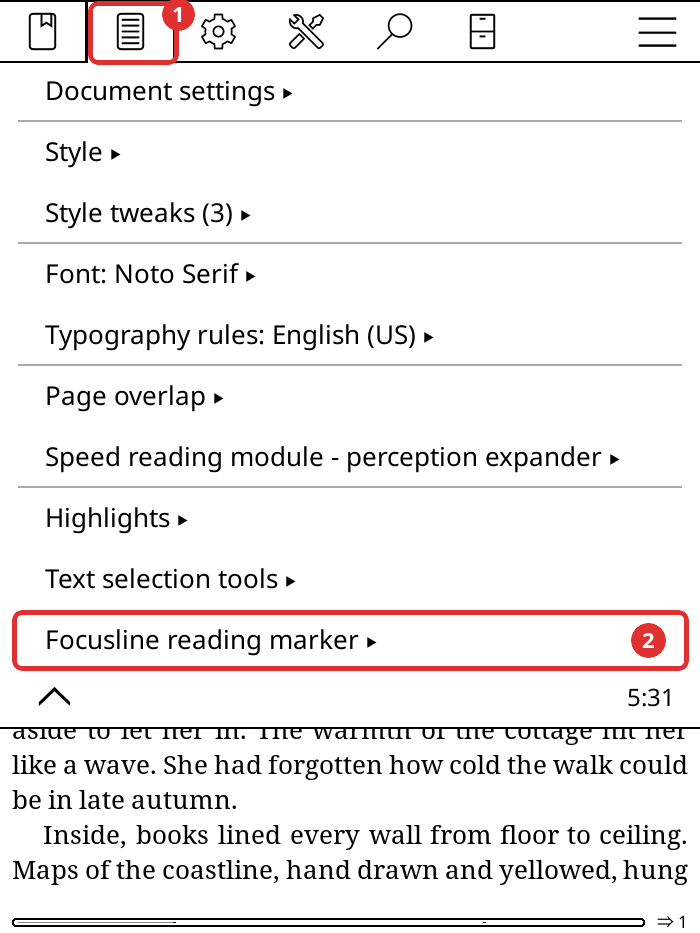 | 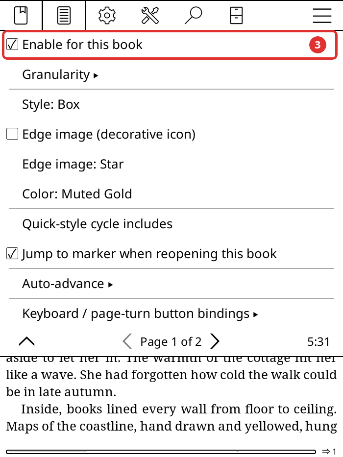 |

Close the menu by tapping the book. The first sentence on the page is now
marked. You turn Focusline on once for each book you want it in.

### 2. Move the marker

**With page-turn buttons.** Press *next page* to move the marker forward and
*previous page* to move it back. At the end of the page, the page turns and
the marker carries on at the top of the next one. This also works with a
Bluetooth page turner or a keyboard.

**On a device without buttons.** Give the marker a gesture, such as a tap in
a corner of the screen:

1. Show the menu and tap the **gear icon**.
2. Tap **Taps and gestures**, then **Gesture manager**.
3. Pick a gesture, for example **Tap corner**, then **Bottom right**.
4. Tap **Reader**, then tick **Focusline: move marker forward**.

Do the same with another corner and **Focusline: move marker backward** if
you want to go back as well.

**Hands-free.** Let the marker move by itself. In the Focusline menu, tap
**Auto-advance**, tick **Enable auto-advance**, and choose a mode:

- **Manual**: the marker stays on each sentence for the same amount of
  time, an interval you set in milliseconds.
- **Auto**: the time is worked out from the sentence itself. Longer
  sentences get more time, short ones less, based on a reading speed (words
  per minute) you set.

It pauses when you turn a page yourself, and picks up again once you are
back on the marker's page.

**Persistent marker.** On by default. With it on, turning pages yourself
(by button, tap or swipe) never moves the marker: it stays on its sentence
and its page. Pressing the button that moves the marker forward or backward
first brings you back to wherever the marker is, then moves it from there.
There is also a **Move marker to this page** action in the Focusline menu,
for when you want to bring the marker to the page you are looking at
yourself. Turn persistent marker off if you would rather have the marker
always jump to the top of whatever page you turn to, as in earlier
versions.

### 3. Make it yours

Tap the marker itself. A small window opens:

- **Colors**: tap one and the marker changes straight away.
- **Note**: write a note on the marked sentence.
- **Style**: choose one of the 17 styles.
- **Adjust**: make the marked part a little longer or shorter.
- **More**: remove the marker, or copy, look up or translate the marked text.

Everything else is in the Focusline menu:

| The Focusline menu | Colors |
| --- | --- |
| 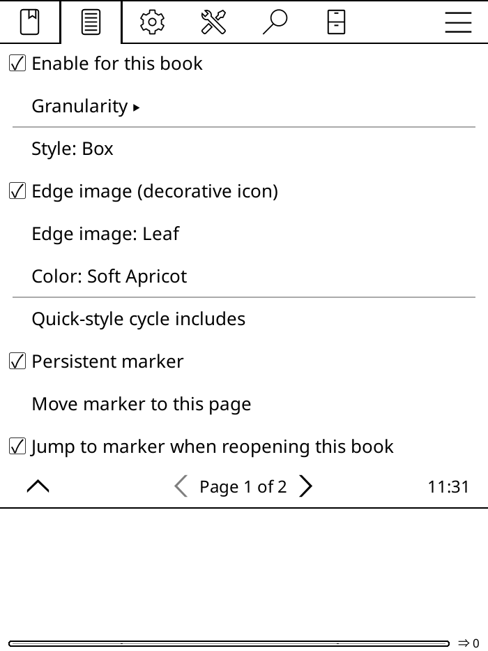 | 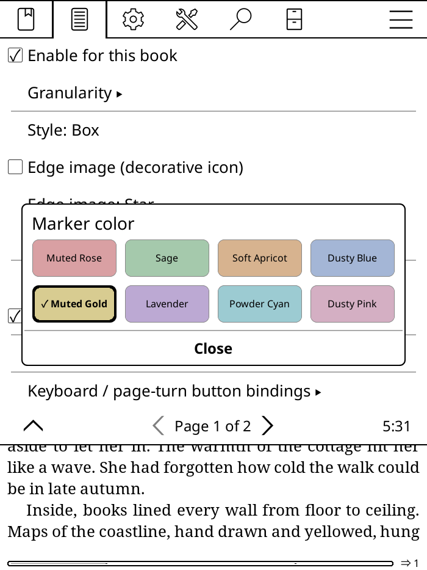 |
| **Styles** | **Picture beside the line** |
| 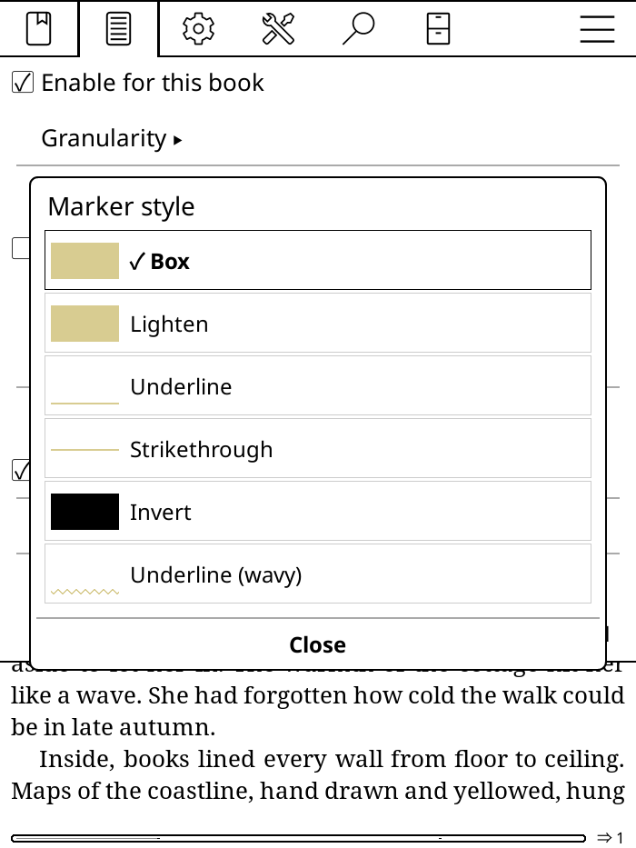 | 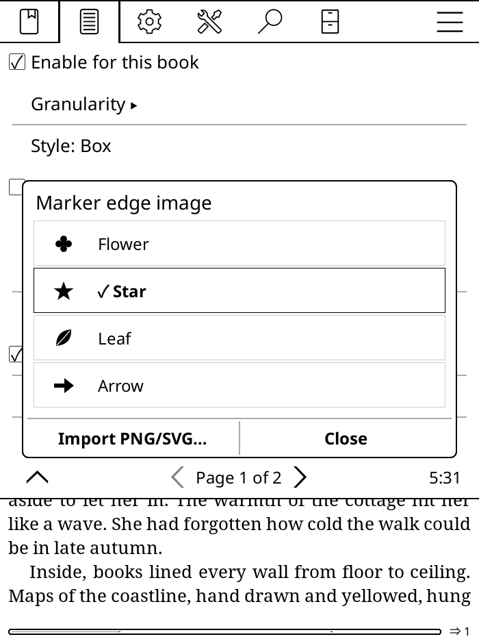 |

| Menu entry | What it does |
| --- | --- |
| Enable for this book | Turns the marker on or off for the book you are reading. |
| Granularity | Mark a whole sentence or a single word. |
| Style | How the marker is drawn. |
| Edge image (decorative icon) | Shows or hides the small picture beside the marked line. |
| Edge image | Which picture to show. **Import PNG/SVG…** lets you use your own. |
| Color | The color of the marker. |
| Quick-style cycle includes | Which styles the "cycle marker style" gesture goes through. |
| Persistent marker | Keeps the marker on its page and sentence while you turn pages yourself. On by default. |
| Move marker to this page | Brings the marker to the page you are currently looking at. |
| Jump to marker when reopening this book | Opens the book on the page where the marker is. On by default. |
| Auto-advance | Moves the marker by itself, on a manual interval or a reading-speed-based timer. |
| Keyboard / page-turn button bindings | Lets the page-turn buttons move the marker. On by default. Untick it to make the buttons turn pages again. |
| Notify on auto-advance pause | Shows a short message when auto-advance pauses. |

### Good to know

- The marker is saved inside the book as a normal KOReader highlight. You
  will see it in your bookmark list, and you can delete it there like any
  other highlight.
- There is only one marker in a book. It is removed when you reach the end.
- On a black-and-white screen the colors show as shades of gray. The names
  on the color buttons tell you which is which.

## Which books work

| Works | Does not work |
| --- | --- |
| EPUB, FB2, MOBI, TXT, HTML | Comics and manga (CBZ) |
| PDF and DJVU files that contain real text | Scanned pages that are only pictures |

A quick test for a PDF: if you can select words in it with your finger,
Focusline can mark them. If a book cannot be marked, Focusline tells you so
when you try to turn it on.

Tested with KOReader 2026.07.

## Support

Focusline is free. If it makes your reading nicer, you can buy me a coffee.
Thank you!

